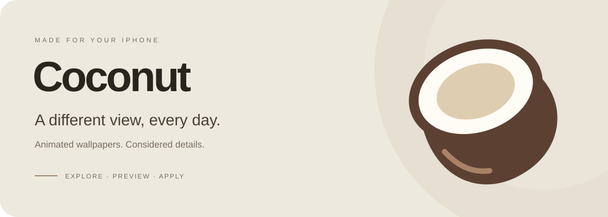
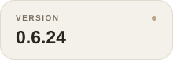

  

  

Counts checked October 22, 2026. Downloads count IPA files only. Open the links for current totals.

  

  

**Created by [Leonardo](https://github.com/leonardob8777-bit). Designed around your wallpaper.**

[Report a problem](https://github.com/leonardob8777-bit/Coconut-Catalog/issues/new?template=bug_report.yml) · [Suggest an idea](https://github.com/leonardob8777-bit/Coconut-Catalog/issues/new?template=feature_request.yml) · [All releases](https://github.com/leonardob8777-bit/Coconut-Catalog/releases)

---

## Your wallpaper, in motion

Explore the collection, watch a moving preview inside an iPhone frame, and keep your favorites close. Coconut downloads wallpapers when you need them, keeping the app small.

| Explore | Preview | Make it yours |
| :--- | :--- | :--- |
| **76 curated themes** in the current collection. Search, filter and save favorites. | **Motion previews**, a softly blurred backdrop and a decorative showcase that advances at the end of each video. | **Apply with your saved PosterBoard UUID.** Configure it once; reuse it for subsequent themes. |

## A lighter, smoother Coconut

**0.6.23 · build 33 · 4.17 MB · preview release**

- MP4 playback with local caching and preloading of the next showcase video.
- A refined scrolling header with a fixed iPhone preview, softer blur and a pinned collection title.
- Selected **HOT** themes and a creator card in Settings.
- English by default, with Spanish available in Settings.
- Wallpapers and videos stay online until requested; they are not packed into the IPA.

[Read the full release notes →](https://github.com/leonardob8777-bit/Coconut-Catalog/releases/tag/v0.6.23)

## Install

1. **[Download Coconut.ipa](https://github.com/leonardob8777-bit/Coconut-Catalog/releases/download/v0.6.23/Coconut-0.6.23-33.ipa).**
2. Sign and install it using your preferred sideloading method.
3. Open Coconut and configure your PosterBoard UUID in Settings, if needed.
4. Pick a theme, watch its preview and tap **Apply**.

The supplied development signature is limited to one registered device and expires **October 24, 2026 at 01:06 UTC**. Other devices need their own compatible signing method. Coconut is not distributed through the App Store.

<strong>Compatibility and verification</strong>

The app requires iOS 17.0 or later to launch. Wallpaper installation has narrower device and iOS requirements; the minimum app version is not a promise that every iOS version can apply themes. Automatic UUID discovery remains limited to the documented iPhone 16 Pro / iOS 18.6.2 target. Manual UUID entry is also available.

This release does not expand engine compatibility. The exact public IPA was downloaded and its SHA-256 matched the local build. All 152 package/video links were accessible at publication. The 23 portable tests passed; 9 of 33 iOS experience tests still use expectations from the previous catalog and need updating. This build was not newly validated on a physical iPhone during the release review.

[Verification and checksums](https://github.com/leonardob8777-bit/Coconut-Catalog/releases/tag/v0.6.23)

<strong>Español</strong>

Coconut es una app de fondos animados para iPhone creada por **Leonardo**. Explora los 76 temas actuales, mira sus vídeos, guarda favoritos y aplica con el UUID de PosterBoard que hayas configurado.

Descarga la IPA desde el botón superior y fírmala con tu método habitual. La versión actual es **0.6.23 (33)**, pesa **4,17 MB** y se publica como versión de prueba. Puedes elegir español en Ajustes. Consulta los límites de compatibilidad y las notas antes de instalar.

## Catalog & credits

`catalog.json` supplies theme metadata, HTTPS download links and SHA-256 package digests. `scripts/add-theme.sh` adds a theme with its own release. Publish a revised package and its new digest together. Preview videos do not certify the final appearance on a physical iPhone.

Coconut's combined application is distributed under **AGPL-3.0**, with the original notices retained for its components. Thanks to **leminlimez / Pocket Poster**, **Eagle/Lara and their contributors**, and **Thomas Zoechling / ZIPFoundation**. Full attribution and licenses accompany the [source download](https://github.com/leonardob8777-bit/Coconut-Catalog/releases/download/v0.6.23/Coconut-0.6.23-source.zip). Wallpaper artwork and the Coconut brand have separate terms; they are not automatically licensed as application code.

---

Coconut · Created by Leonardo · A different view, every day.

